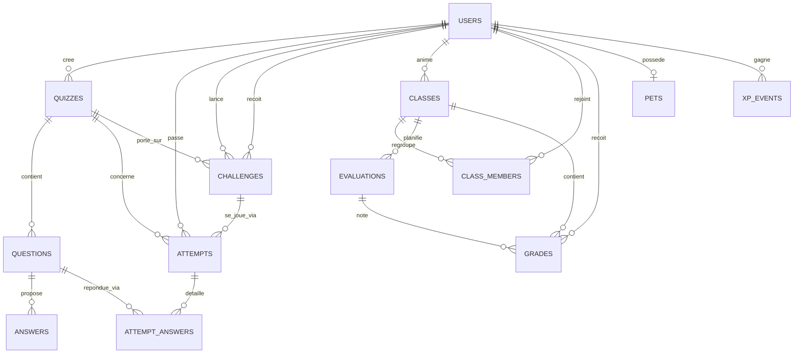

# Cahier des charges

Projet scolaire imposé (scénario TechLearn Solutions) · Réf. CDD-QUIZ-2026-001 · Équipe : binôme

## Contexte

### Présentation du projet

TechLearn Solutions est un organisme de formation fictif, spécialisé dans les métiers de l'informatique, notamment pour les étudiants en BTS SIO. Ce scénario sert de cadre pédagogique imposé par l'intervenant.

TechLearn souhaite une plateforme de quiz interactifs pour :

- Évaluer les connaissances des étudiants de manière ludique et efficace
- Renforcer l'engagement des apprenants via des défis, des classements et un compagnon virtuel
- Faciliter le suivi des progrès par les formateurs
- Automatiser la correction des exercices

Le projet est réalisé par un binôme, ce qui diffère de l'équipe de 7 personnes prévue dans le document d'origine. Cette contrainte guide les choix de périmètre (voir Spécifications Fonctionnelles) et de planning.

### Point de départ

Le projet reprend une application personnelle de révision réalisée par un membre du binôme, « Slay your enemies » : une application web où un dragon de compagnie grandit avec la régularité des révisions. De cette base, le projet conserve la charte graphique (pixel art, thème sombre), les composants d'interface et les règles de progression du dragon. Les fonctions propres à un usage personnel (import de cours, fiches de révision, répétition espacée, stockage local) sont retirées : elles sortent du périmètre de ce cahier des charges.

## Objectifs du Projet

### Objectifs Principaux

- Créer une plateforme de quiz personnalisables pour les formateurs
- Permettre aux étudiants de répondre aux quiz via une interface mobile-first
- Intégrer un système de défis entre étudiants
- Organiser les étudiants en classes, avec les dates d'évaluation et les notes saisies par le formateur
- Fournir des statistiques et un tableau de suivi aux formateurs
- Garantir une synchronisation en temps réel des résultats et classements

### Objectifs Secondaires

- Récompenser la régularité des étudiants par un dragon de compagnie qui grandit
- Partage de quiz entre formateurs ou par classe
- Export des résultats (PDF, CSV)

## Spécifications Fonctionnelles

Chaque fonctionnalité est classée MVP (nécessaire à la soutenance) ou Bonus (ajoutée si le temps le permet), pour tenir un planning réaliste en binôme.

### Rôles

| Rôle | Accès |
|---|---|
| Formateur | Crée les quiz, les classes, les évaluations et les notes ; suit ses élèves. N'a pas de dragon. |
| Étudiant | Rejoint des classes, répond aux quiz, lance des défis ; consulte ses notes, ses évaluations et son dragon. |

Le rôle est choisi à l'inscription.

### Fonctionnalités Formateurs

| ID | Fonctionnalité | Description | Statut |
|---|---|---|---|
| F-001 | Création de quiz | Titre, thème, difficulté, temps par question ; brouillon ou publié | MVP |
| F-002 | Gestion des questions | Ajouter, modifier, supprimer des questions QCM, Vrai/Faux, texte libre | MVP |
| F-003 | Catégorisation des quiz | Par thème et niveau de difficulté | MVP |
| F-004 | Partage de quiz | Entre formateurs, ou réservé à une classe | Bonus |
| F-005 | Suivi des résultats | Statistiques par quiz (question la plus échouée, temps moyen) et par étudiant | MVP |
| F-006 | Export des données | Export PDF ou CSV des résultats et des notes | Bonus |
| F-007 | Correction automatique | QCM et Vrai/Faux automatiques ; texte libre corrigé à la main par le formateur | MVP |
| F-008 | Création de défis | Défis entre étudiants sur un quiz | MVP |
| F-009 | Gestion des classes | Créer une classe, obtenir un code d'invitation, retirer un étudiant | MVP |
| F-010 | Dates d'évaluation | Contrôle, examen ou projet, daté, avec un thème facultatif, pour une classe | MVP |
| F-011 | Saisie des notes | Carnet de notes par classe : une colonne par évaluation, barème et coefficient, saisie de toute la classe en une fois | MVP |
| F-012 | Tableau de suivi | Pour chaque étudiant d'une classe : dragon, moyenne, activité de la semaine, plans de rattrapage, alerte d'inactivité | MVP |

### Fonctionnalités Étudiants

| ID | Fonctionnalité | Description | Statut |
|---|---|---|---|
| E-001 | Accès aux quiz | Filtres par thème, difficulté, formateur | MVP |
| E-002 | Répondre aux quiz | Une question à la fois, correction et explication après chaque réponse | MVP |
| E-003 | Timer par question | Temps de réponse limité par question, vérifié par le serveur | MVP |
| E-004 | Système de jokers | 50/50, passer une question | Bonus |
| E-005 | Classement | Par quiz, meilleurs scores et temps | MVP |
| E-006 | Historique des quiz | Consultation des anciens résultats | MVP |
| E-007 | Défi entre étudiants | Défis mutuels sur un quiz, entre membres d'une classe | MVP |
| E-008 | Notifications | Nouveaux quiz, défis, résultats | Bonus |
| E-009 | Rejoindre une classe | Avec le code donné par le formateur ; quitter une classe | MVP |
| E-010 | Notes et évaluations | Consultation de ses notes, de sa moyenne et des évaluations à venir | MVP |
| E-011 | Dragon de compagnie | Dragon qui gagne de l'XP et grandit (oeuf, bébé, jeune) ; nom personnalisable | MVP |

### Fonctionnalités Techniques

| ID | Fonctionnalité | Description | Statut |
|---|---|---|---|
| T-001 | Authentification | Email/mot de passe pour le MVP, OAuth en bonus | MVP |
| T-002 | Base de données | Base relationnelle (PostgreSQL) | MVP |
| T-003 | API REST | Communication frontend/backend | MVP |
| T-004 | Synchronisation temps réel | Classements et défis via WebSocket | MVP |
| T-005 | Stockage des images | Images dans les questions (schémas réseau, etc.) | Bonus |
| T-006 | Responsive Design | Compatible mobile et web | MVP |
| T-007 | Mode hors ligne | Réponse aux quiz hors ligne, synchronisation automatique | Bonus, à tenter seulement une fois le MVP stable (fonctionnalité la plus coûteuse en temps) |
| T-008 | Mode démonstration | Comptes, classe, quiz et notes d'exemple, connexion sans mot de passe, pour la soutenance ; désactivé en production | MVP |

### Règles de progression du dragon (E-011)

Le dragon récompense la régularité et la maîtrise, jamais le volume brut. Il ne perd jamais d'XP ni de niveau : une journée sans quiz remet seulement la série à zéro. Les gains sont calculés par le serveur.

| Gain | XP | Conditions |
|---|---|---|
| Quiz terminé | +15 | Au moins une réponse donnée |
| Maîtrise | +5 par question | Question réussie alors qu'elle avait été ratée lors d'une tentative précédente |
| Série | jusqu'à +50 % | +5 % par jour consécutif avec un quiz |
| Plafond | 60 XP par jour | Sur les gains des quiz uniquement |
| Défi gagné | +10 | Meilleur score, puis temps le plus court ; hors plafond |
| Bonne note | +20 | Note d'au moins 14/20 datée de moins de 14 jours ; hors plafond |
| Plan de rattrapage | +3 par bonne réponse, jusqu'à +15 par quiz | Pendant 14 jours après une note sous 10/20, sur les quiz du même thème |

Stades : oeuf (niveaux 1 à 4), bébé (5 à 14), jeune (15 et plus). L'architecture permet d'ajouter un stade sans modifier le code (une entrée de configuration et un sprite).

## Spécifications Techniques

### Environnement Technique

| Composant | Technologie | Justification |
|---|---|---|
| Frontend Mobile | React Native + TypeScript | Cross-platform, cohérent avec le web (même langage) |
| Frontend Web | React + TypeScript (Vite, Tailwind) | Repris de l'application de départ du binôme |
| Backend | Rust (Axum) | Performant, déjà utilisé sur un projet précédent (Motus) |
| Base de données | PostgreSQL (sqlx, migrations versionnées) | Bon support dans l'écosystème Rust |
| Authentification | JWT maison (Rust), mots de passe hachés avec bcrypt | Géré directement côté backend |
| Stockage des fichiers | Cloudflare R2 ou équivalent S3-compatible | Pour les images des questions (fonctionnalité bonus) |
| Hébergement backend | Fly.io ou Shuttle.rs | Tier gratuit adapté à Rust, contrairement à Heroku |
| Hébergement web | Vercel ou Netlify | Gratuit, déploiement direct depuis GitHub |
| Environnement local | Docker Compose (PostgreSQL) | Même base pour les deux membres du binôme |

### Architecture des données



| Table | Rôle |
|---|---|
| `users` | Comptes, avec le rôle `student` ou `trainer` |
| `quizzes`, `questions`, `answers` | Contenu des quiz |
| `attempts`, `attempt_answers` | Tentatives et réponses des étudiants, base des statistiques (F-005) |
| `challenges` | Défis entre étudiants (`pending`, `accepted`, `declined`, `completed`) |
| `classes`, `class_members` | Classes d'un formateur et leurs étudiants ; code d'invitation unique |
| `evaluations` | Dates d'évaluation d'une classe (`controle`, `examen`, `projet`) |
| `grades` | Notes : valeur, barème, coefficient, date, matière ; liées ou non à une évaluation |
| `pets` | Dragon de chaque étudiant : XP, niveau, série |
| `xp_events` | Historique des gains d'XP (quiz, défi gagné, bonne note) |

Points d'attention :

- `attempt_answers` sert de base au calcul des statistiques (F-005) : question la plus échouée, temps moyen.
- `answers.is_correct` permet la correction automatique QCM/Vrai-Faux. Pour une question en texte libre, `answers` contient au plus une ligne : la réponse attendue, indicative pour le formateur. C'est `attempt_answers.is_correct` qui reste nul en attendant la correction manuelle.
- Une seule réponse par question et par tentative (`UNIQUE (attempt_id, question_id)`) ; un étudiant ne peut pas se défier lui-même.
- La matière d'une note est comparée au thème des quiz pour le plan de rattrapage.
- Le schéma complet est maintenu dans `docs/schema.dbml` (dbdiagram.io) et appliqué par les migrations de `backend/migrations/`.

### Structure de l'API (Axum)

```
src/
  main.rs
  demo.rs            // mode démonstration (T-008)
  xp.rs              // règles de progression du dragon, testées
  db/
    mod.rs           // pool sqlx, migrations
  models/
    user.rs, quiz.rs, question.rs, attempt.rs, challenge.rs
  routes/
    auth.rs          // POST /auth/register, /auth/login, /auth/demo
    quizzes.rs       // CRUD /quizzes, /quizzes/{id}/questions, statistiques, correction
    attempts.rs      // POST /attempts, /attempts/{id}/answers, /attempts/{id}/finish
    leaderboard.rs   // GET /quizzes/{id}/leaderboard
    challenges.rs    // POST /challenges, PATCH /challenges/{id}
    classes.rs       // /classes, /classes/join, /classes/{id}/dashboard
    evaluations.rs   // /classes/{id}/evaluations, /evaluations
    grades.rs        // /classes/{id}/grades, /me/grades
    pet.rs           // /me/pet
  ws/
    mod.rs           // gestion des connexions WebSocket
  middleware/
    auth.rs          // vérification JWT
```

La documentation complète des routes est dans `docs/API.md`.

### Temps réel

Un seul endpoint `/ws` avec un système de rooms :

- `quiz:{id}` : quand un étudiant termine une tentative, ou qu'une réponse en texte libre est corrigée, le serveur diffuse le classement mis à jour à tous les clients connectés sur cette room.
- `challenge:{id}` : notifie les deux participants de chaque changement d'état du défi.
- `user:{id}` : notifie un étudiant d'un défi reçu.

Le serveur vérifie les droits avant chaque abonnement : quiz visible, participant au défi, ou son propre identifiant.

## Planning Prévisionnel

Démarrage : 25 septembre 2026. Deadline école : 31 mars 2027. Calendrier étalé à 20 semaines (contre 15 dans le document d'origine pensé pour une équipe de 7), pour tenir compte du binôme tout en gardant une marge de sécurité d'environ 6 semaines.

| Phase | Tâches | Durée | Dates | Livrables |
|---|---|---|---|---|
| 1. Analyse et Conception | Cahier des charges, maquettes Figma, schéma de la base de données | 2 semaines | 25 sept → 9 oct 2026 | Cahier des charges, maquettes, schéma SQL |
| 2. Développement Backend | Base de données, API REST (quiz, classes, notes, dragon), temps réel, documentation, mode démo | 4 semaines | 9 oct → 6 nov 2026 | API fonctionnelle, documentation technique |
| 3. Développement Frontend Mobile | UI React Native côté étudiant : quiz, timer, classement, défis, dragon, notes | 6 semaines | 6 nov → 18 déc 2026 | Application mobile fonctionnelle |
| 4. Développement Frontend Web | Interface React + TypeScript : espace formateur (quiz, classes, évaluations, carnet de notes, suivi) et espace étudiant | 3 semaines | 18 déc 2026 → 8 jan 2027 | Application web fonctionnelle |
| 5. Intégration et Tests | Intégration frontend/backend, tests unitaires et de bout en bout, vérification RGPD et sécurité | 3 semaines | 8 jan → 29 jan 2027 | Rapport de tests, corrections de bugs |
| 6. Déploiement | Déploiement backend et frontend, configuration du domaine, APK pour la soutenance | 1 semaine | 29 jan → 5 fév 2027 | Application déployée et accessible |
| 7. Formation et Documentation | Documentation utilisateur, support de soutenance | 1 semaine | 5 fév → 12 fév 2027 | Guide utilisateur, support de soutenance |

## Budget Prévisionnel

| Poste | Coût estimé | Détails |
|---|---|---|
| Hébergement backend (Rust) | 0 à ~7 €/mois | Fly.io ou Shuttle.rs, tier gratuit suffisant |
| Hébergement web | 0 € | Vercel / Netlify |
| Nom de domaine | 12-20 €/an | Optionnel |
| Base de données PostgreSQL | 0 € | Instance gratuite incluse chez Fly.io/Shuttle/Neon |
| Distribution mobile | 0 € (APK/TestFlight) ou 25 $ + 99 $/an | Gratuit en ad-hoc pour la soutenance, frais uniquement si publication sur les stores |
| Outils (Figma, GitHub, Trello, Docker) | 0 € | Versions gratuites |
| **Total estimé** | **~0 à 30 €/an** | Bien en dessous du plafond de 12 000 € du document d'origine |

## Contraintes

- Délai : livraison avant le 31 mars 2027
- Compatibilité : mobile (Android/iOS via React Native) et web
- Sécurité : chiffrement des mots de passe (bcrypt), HTTPS, validation des entrées côté serveur, contrôle d'accès selon le rôle et l'appartenance à la classe
- RGPD : les notes et l'activité d'un étudiant ne sont visibles que de lui-même et du formateur de sa classe ; information des étudiants sur les données collectées ; droit à l'effacement (suppression de compte)
- Le mode démonstration ne doit jamais être activé en production
- Accessibilité : contraste des couleurs, taille des textes ajustable, navigation au clavier pendant un quiz

## Rôles et Responsabilités

Adapté pour un binôme (répartition à ajuster avec le coéquipier) :

| Rôle | Responsabilités | Qui |
|---|---|---|
| Coordination | Suivi du planning, reporting | Les deux |
| Backend | API REST, base de données, temps réel | À répartir |
| Frontend | UI mobile/web, logique métier | À répartir |
| Design UI/UX | Maquettes Figma, sprites et icônes pixel | À répartir |
| Tests | Tests fonctionnels, corrections | Les deux |

## Critères de Réussite

- Toutes les fonctionnalités MVP implémentées et testées
- Temps de réponse de l'API raisonnable pour un usage en soutenance
- Application stable, sans crash critique en démonstration
- Démonstration possible sans préparation grâce au mode démo
- Respect du RGPD sur les données étudiantes (notes, activité)
