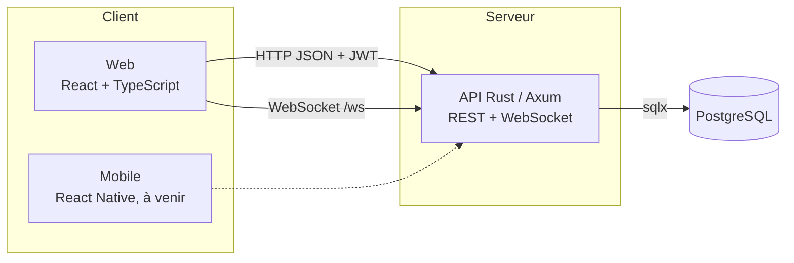

# Documentation technique

Comment le projet a été construit, pourquoi chaque choix a été fait, et comment les éléments fonctionnent. Les besoins fonctionnels sont dans [CAHIER_DES_CHARGES.md](CAHIER_DES_CHARGES.md), les routes dans [API.md](API.md), le lancement dans [LANCER_EN_LOCAL.md](LANCER_EN_LOCAL.md).

## 1. Vue d'ensemble



Le dépôt est un monorepo :

| Dossier | Contenu | Taille |
|---|---|---|
| `backend/` | API Rust : `src/` (code), `migrations/` (schéma SQL), `scripts/smoke.sh` (test de bout en bout) | ~3 100 lignes |
| `web/` | Application React : `src/pages/`, `src/components/`, `src/api/`, `src/stores/` | ~3 400 lignes |
| `docs/` | Documentation, schéma DBML | |
| `docker-compose.yml` | PostgreSQL de développement | |

Toute la logique métier (droits, correction, score, XP du dragon) est dans l'API. Les clients ne font qu'afficher et envoyer des actions. Cela permet d'ajouter le client mobile sans dupliquer de règles, et empêche un étudiant de tricher en modifiant le code de son navigateur.

## 2. Comment le projet a été construit

| Étape | Ce qui a été fait |
|---|---|
| 1. Point de départ | Application personnelle « Slay your enemies » : React, stockage local dans le navigateur (IndexedDB via Dexie), dragon de compagnie, PWA. Un seul utilisateur, pas de serveur. |
| 2. Monorepo | L'application est déplacée dans `web/`, `backend/` est créé. Les 73 tests de l'application d'origine passent toujours après le déplacement. |
| 3. Schéma SQL | Le livrable dbdiagram de la Phase 1 est traduit tel quel en migration (`0001_schema_initial.sql`), avec quelques contraintes en plus (section 5). |
| 4. API de quiz | Authentification, quiz, questions, tentatives, correction, classement, défis, statistiques, WebSocket. Testée par `scripts/smoke.sh`. |
| 5. Connexion du web | Page de connexion, choix du rôle, session, mode démo. |
| 6. Recentrage | Décision du binôme : classes, évaluations et notes réservées au formateur ; dragon réservé à l'étudiant et visible du formateur ; retrait des outils perso (cours, fiches, répétition espacée, rappels, Dexie). Migration `0002`, règles du dragon portées en Rust. |
| 7. Écrans | Passage d'un quiz, éditeur de quiz, carnet de notes, tableau de suivi. |
| 8. Direction artistique | Cases pixel, icônes dessinées, recadrage des sprites, vérifié par captures d'écran dans Chrome. |

## 3. Choix techniques

### Backend

| Choix | Pourquoi | Alternative écartée |
|---|---|---|
| **Rust + Axum 0.8** | Déjà utilisé par le binôme (projet Motus). Typage strict : une route qui oublie un cas ne compile pas. Un seul binaire à déployer, peu gourmand, adapté aux offres gratuites. | Node/Express : plus rapide à écrire, mais erreurs découvertes à l'exécution. |
| **Tokio** | Moteur asynchrone standard de Rust, requis par Axum et sqlx. Un serveur gère beaucoup de connexions WebSocket ouvertes sans un thread par client. | |
| **sqlx 0.9** sans vérification à la compilation | Requêtes SQL écrites à la main, lisibles et proches du schéma. Les requêtes sont construites avec `query_as::<_, Type>` (vérifiées à l'exécution) plutôt qu'avec les macros `query!` (vérifiées à la compilation) : ces macros exigent une base de données joignable pour compiler, ce qui compliquerait le travail à deux et le déploiement. Le test `smoke.sh` compense en exécutant toutes les requêtes. | Diesel (ORM) : plus de code généré, SQL moins visible, plus difficile à expliquer en soutenance. |
| **PostgreSQL** | Relationnel (le modèle est très relié), enums natifs, `gen_random_uuid()`, `FILTER` et `DISTINCT ON` pour les statistiques et le classement. Offres gratuites chez Fly.io et Neon. | |
| **UUID** comme identifiants | Pas d'identifiants devinables dans les URL (`/quizzes/1`, `/quizzes/2`…). | Entiers auto-incrémentés. |
| **JWT maison** (`jsonwebtoken`) | Pas de session à stocker côté serveur ; le jeton porte l'identifiant et le rôle ; durée 7 jours. | Sessions en base : un aller-retour SQL de plus à chaque requête. |
| **bcrypt** | Hachage lent et salé, exigé par le CDC. | |
| **Migrations au démarrage** | `sqlx::migrate!()` applique les fichiers de `migrations/` à chaque lancement : les deux membres du binôme ont toujours le même schéma. | |

### Frontend

| Choix | Pourquoi |
|---|---|
| **React 18 + TypeScript + Vite** | Repris de l'application de départ. TypeScript partage les types de l'API entre les pages ; il sera réutilisé tel quel dans React Native. |
| **Tailwind CSS 4 + variables CSS** | Toutes les couleurs sont des variables (`styles/tokens.css`), jamais en dur dans les composants : la charte est modifiable à un seul endroit. |
| **Zustand** pour la session seulement | Seul état global réel : l'utilisateur connecté. Le reste est chargé page par page. |
| **Pas de bibliothèque de requêtes** (React Query, SWR…) | Un client de 60 lignes (`api/client.ts`) et un hook de 40 lignes (`api/useApi.ts`) suffisent, et restent entièrement explicables. |
| **React Router 7** | Routes et gardes par rôle. |
| **Vitest + Testing Library** | Même outillage que Vite, tests dans un faux navigateur (jsdom). |
| **oxlint** | Linter rapide, détecte aussi les erreurs propres à React. |
| **PWA** (service worker Workbox) | Conservée de la base : l'application s'installe et l'interface se charge vite. Les données, elles, viennent de l'API. |

### Environnement

- **Docker Compose** pour PostgreSQL : même version de la base chez les deux membres du binôme, sans installation (port 5433, pour ne pas gêner un PostgreSQL déjà installé).
- **Fichier `.env`** non versionné : chacun garde ses secrets (`DATABASE_URL`, `JWT_SECRET`, `DEMO_MODE`). `.env.example` sert de modèle.

## 4. Backend en détail

### Démarrage

`main.rs` lit `.env`, ouvre un pool de 10 connexions PostgreSQL, applique les migrations, crée les données de démo si `DEMO_MODE=true`, puis assemble les routeurs :

```rust
Router::new()
    .merge(routes::auth::router())
    .merge(routes::quizzes::router())
    // … un routeur par domaine
    .layer(CorsLayer::permissive())
    .layer(TraceLayer::new_for_http())
    .with_state(state)
```

`AppState` est partagé par toutes les routes : le pool de connexions, le secret JWT et le `Hub` du temps réel. Axum le clone pour chaque requête (les éléments sont des pointeurs partagés, la copie ne coûte rien).

### Organisation par domaine

Chaque fichier de `routes/` expose une fonction `router()` et contient ses handlers, ses corps de requête (`Deserialize`) et ses réponses (`Serialize`). Les helpers partagés suivent tous le même modèle :

| Helper | Rôle |
|---|---|
| `owned_quiz` | Charge un quiz et vérifie que l'utilisateur est formateur et auteur |
| `visible_quiz` | Quiz publié, ou brouillon de son auteur |
| `owned_class` | Classe dont l'utilisateur est le formateur |
| `participant_challenge` | Défi dont l'utilisateur est l'un des deux joueurs |
| `own_attempt` | Tentative de l'utilisateur |

Un handler commence presque toujours par l'un d'eux : le contrôle d'accès est fait avant toute modification. Quand l'utilisateur n'a pas le droit de savoir qu'une ressource existe (le quiz brouillon d'un autre formateur), la réponse est 404 et non 403.

### Authentification

`middleware/auth.rs` définit `AuthUser`, un **extracteur** Axum : il suffit de l'ajouter en paramètre d'un handler pour exiger un jeton valide.

```rust
async fn create_quiz(State(state): State<AppState>, auth: AuthUser, Json(body): Json<QuizBody>) -> AppResult<…> {
    auth.require_trainer()?;   // 403 si l'utilisateur n'est pas formateur
```

L'extracteur lit l'en-tête `Authorization: Bearer <jwt>`, vérifie la signature et la date d'expiration, et fournit `{ id, role }`. Sans jeton valide, la requête est rejetée en 401 avant même d'entrer dans le handler.

À l'inscription, l'email est mis en minuscules et vérifié, le mot de passe doit faire 8 caractères, puis il est haché avec bcrypt. `ON CONFLICT (email) DO NOTHING` évite une erreur SQL en cas d'email déjà pris : l'API répond proprement 409.

### Gestion des erreurs

`error.rs` définit `AppError` (`BadRequest`, `Unauthorized`, `Forbidden`, `NotFound`, `Conflict`, `Db`). Chaque handler renvoie `AppResult<T>` et utilise `?` : une erreur SQL remonte automatiquement. `AppError` se convertit en réponse HTTP `{ "error": "message" }` avec le bon code. Les erreurs de base de données sont journalisées côté serveur, mais le client ne reçoit que « erreur interne » : aucun détail SQL ne fuit.

Les violations de contraintes uniques sont traduites en messages clairs (« question déjà répondue », « position déjà prise »).

### Passage d'un quiz et correction

1. `POST /attempts` crée une tentative (vérifie que le quiz est publié ; pour un défi, qu'il est accepté et pas encore joué par cet étudiant).
2. `POST /attempts/{id}/answers`, une fois par question :
   - la question doit appartenir au quiz de la tentative, la réponse à la question ;
   - **timer** : si `time_ms` dépasse le temps du quiz + 1 seconde de marge réseau, la réponse est fausse ;
   - QCM et Vrai/Faux : `is_correct` est recopié depuis `answers.is_correct` ;
   - texte libre : `is_correct` reste `NULL` jusqu'à la correction du formateur ;
   - la contrainte `UNIQUE (attempt_id, question_id)` empêche de répondre deux fois.
   La réponse renvoie la correction et l'explication, pour l'affichage immédiat.
3. `POST /attempts/{id}/finish` calcule le score en SQL (somme des points des bonnes réponses) et le temps total, attribue l'XP du dragon, diffuse le classement, et termine le défi si les deux joueurs ont fini.

**Les bonnes réponses ne quittent jamais le serveur avant la réponse de l'étudiant** : `load_questions(…, reveal: false)` retire `is_correct` de toutes les réponses et supprime la réponse attendue des questions en texte libre.

Quand le formateur corrige un texte libre, `recompute_score` recalcule le score de la tentative et rediffuse le classement.

### Classement

Une seule requête, avec `DISTINCT ON` de PostgreSQL pour garder la meilleure tentative de chaque étudiant :

```sql
SELECT * FROM (
    SELECT DISTINCT ON (a.user_id) a.user_id, u.display_name, a.score, a.total_time_ms
    FROM attempts a JOIN users u ON u.id = a.user_id
    WHERE a.quiz_id = $1 AND a.finished_at IS NOT NULL
    ORDER BY a.user_id, a.score DESC, a.total_time_ms ASC
) best
ORDER BY score DESC, total_time_ms ASC
LIMIT 50
```

### Temps réel

`ws/mod.rs` contient un `Hub` construit sur un seul canal de diffusion Tokio (`broadcast::channel(256)`). Chaque message porte le nom de sa room (`quiz:…`, `challenge:…`, `user:…`).

- Chaque connexion WebSocket s'abonne au canal et garde la liste de ses rooms.
- Une boucle `tokio::select!` écoute en parallèle les messages du client (`subscribe`, `unsubscribe`) et les diffusions du serveur ; elle ne transmet que ce qui concerne ses rooms.
- Avant un abonnement, `can_join` vérifie les droits (quiz visible, participant au défi, son propre identifiant).
- Le jeton est passé dans l'URL (`/ws?token=…`), car les navigateurs ne permettent pas d'ajouter un en-tête `Authorization` à une connexion WebSocket.

Ce modèle (un canal, filtrage par connexion) est simple et suffit largement pour une classe. À grande échelle, il faudrait un canal par room.

### Dragon et XP

Les règles sont dans `xp.rs`, sous forme de **fonctions pures** (sans base de données) : `apply_quiz`, `apply_bonus`, `active_recovery_plans`, `level_for_xp`… Elles sont reprises de l'application d'origine (`xp.ts`, `grades.ts`) et couvertes par 9 tests unitaires (`cargo test`).

`routes/pet.rs` fait le lien avec la base :

1. ouvre une transaction ;
2. compte les réponses de la tentative, les bonnes réponses, et les questions « maîtrisées » (réussies alors qu'une tentative précédente les avait ratées), en une seule requête avec `FILTER` ;
3. calcule les plans de rattrapage de l'étudiant à partir de ses notes ;
4. charge le dragon avec `SELECT … FOR UPDATE` : la ligne est verrouillée jusqu'à la fin de la transaction, donc deux quiz terminés en même temps ne peuvent pas perdre de l'XP en s'écrasant ;
5. applique `xp::apply_quiz`, enregistre le dragon et une ligne dans `xp_events`.

Le dragon est créé au premier accès (`INSERT … ON CONFLICT DO NOTHING`). La date du jour est prise en heure de Paris (`now() AT TIME ZONE 'Europe/Paris'`) : un serveur hébergé en UTC ne doit pas couper les séries à 1 h ou 2 h du matin.

Les bonus de bonne note (à la saisie de la note) et de défi gagné (à la fin du défi) passent par `award_bonus`, qui ne donne rien à un formateur.

### Classes, évaluations, notes, suivi

- Le **code d'invitation** fait 6 caractères pris dans un alphabet sans `0/O` ni `1/I` (pour éviter les confusions à l'oral ou au tableau). Il est tiré au hasard ; en cas de collision (`ON CONFLICT (join_code) DO NOTHING`), un autre code est essayé.
- La **saisie de notes** est groupée : un seul appel enregistre toute une colonne, dans une transaction. Si une note est invalide (hors barème, élève hors de la classe, date future), rien n'est enregistré.
- Le **tableau de suivi** fait deux requêtes : une pour les élèves, leur dragon et leur activité (sous-requêtes sur `attempts`), une pour toutes leurs notes. Les moyennes et les plans de rattrapage sont calculés en Rust, avec les mêmes fonctions que pour l'élève.

### Mode démo

`demo.rs`, activé par `DEMO_MODE=true` :

- crée au démarrage un formateur, une classe (code `DEMO26`), six élèves à des stades différents, des évaluations, des notes et un quiz ;
- est **idempotent** : relancer l'API ne duplique rien (vérification d'existence, `ON CONFLICT`) ;
- renomme les anciens comptes de démo si leurs noms ont changé, pour garder les données d'une base déjà remplie ;
- ajoute la route `POST /auth/demo`, qui connecte sans mot de passe aux comptes d'exemple. Sans `DEMO_MODE=true`, cette route n'existe pas (404).

Les mots de passe des comptes de démo sont aléatoires et jamais communiqués.

## 5. Base de données

Deux migrations, appliquées dans l'ordre :

| Migration | Contenu |
|---|---|
| `0001_schema_initial.sql` | Le livrable dbdiagram de la Phase 1 : `users`, `quizzes`, `questions`, `answers`, `challenges`, `attempts`, `attempt_answers` |
| `0002_classes_notes_dragons.sql` | `classes`, `class_members`, `evaluations`, `grades`, `pets`, `xp_events` |

Le schéma complet est dans [schema.dbml](schema.dbml).

Choix de modélisation :

- **Enums PostgreSQL** (`user_role`, `question_type`, `challenge_status`…) reliés à des enums Rust par `#[derive(sqlx::Type)]` : une valeur inconnue est refusée par la base et par le compilateur.
- **Contraintes en base** plutôt que seulement dans le code : `UNIQUE (attempt_id, question_id)`, `UNIQUE (quiz_id, position)`, `CHECK (challenger_id <> challenged_id)`, `CHECK (value >= 0 AND value <= max)`… Même un bug de l'API ne peut pas enregistrer une donnée incohérente.
- **Suppressions en cascade** : supprimer un quiz supprime ses questions, tentatives et défis ; supprimer un compte supprime toutes ses données (droit à l'effacement du RGPD).
- **Notes en `double precision`** : les notes ont au plus deux décimales et ne servent qu'à des moyennes ; le type `numeric` aurait demandé une dépendance Rust de plus pour peu de gain.
- **`grades.subject` en texte libre** : il est comparé (sans tenir compte de la casse) au thème des quiz pour le plan de rattrapage. Une table de matières aurait été plus stricte, mais plus lourde à saisir pour le formateur.
- **`class_members`** a une clé primaire composée `(class_id, student_id)` : un élève ne peut pas être deux fois dans la même classe.
- **Index** sur les clés étrangères les plus filtrées (`attempts.quiz_id`, `grades.student_id`…).

## 6. Frontend en détail

### Structure

| Dossier | Rôle |
|---|---|
| `api/client.ts` | Fonction `api(method, path, body)`, types de toutes les réponses de l'API |
| `api/useApi.ts` | Hook de chargement `useApi<T>(path)` → `{ data, error, reload }` |
| `stores/auth.ts` | Session : utilisateur, connexion, inscription, démo, déconnexion |
| `pages/` | Un fichier par écran ; certains écrans ont une version formateur et une version élève |
| `components/` | Éléments réutilisables : boutons, champs, cases pixel, dragon, carnet de notes |
| `domain/pet-stages.ts` | Configuration des stades du dragon (seuils, sprites, zone dessinée) |
| `i18n/` | Tous les textes de l'interface, et le formatage des dates |
| `styles/tokens.css` | Couleurs de la charte |

### Appels à l'API

`api()` ajoute le jeton, sérialise le corps en JSON, et transforme toute erreur en `ApiError` avec le message français renvoyé par le serveur. Une API injoignable donne un message explicite (« vérifie que le backend est lancé »). Les réponses sans contenu (201, 204) sont acceptées.

`useApi` relance la requête quand le chemin change, ignore les réponses arrivées après le démontage de la page, et passe `null` pour ne rien charger (par exemple tant qu'aucune classe n'est choisie).

### Session

Le jeton est gardé dans `localStorage`, dans des `try/catch` : en navigation privée, la session ne survit pas au rechargement mais l'application fonctionne. Au démarrage, `restore()` revérifie le jeton avec `GET /me` avant le premier affichage ; un jeton expiré est effacé.

### Navigation et rôles

`App.tsx` déclare les routes. Le composant `RequireAuth` redirige vers `/connexion` sans session, et vers l'accueil si le rôle ne convient pas (`/dragon` pour l'étudiant, `/suivi` et `/quiz/:id/modifier` pour le formateur). La barre de navigation (`Layout.tsx`) change selon le rôle. Ces gardes servent le confort : la vraie protection est faite par l'API.

### Écran de quiz

`PlayQuizPage` est une petite machine à états : `intro` → `question` → `feedback` → … → `finished`.

- Le **compte à rebours** mesure le temps avec `performance.now()` (insensible aux changements d'heure de l'ordinateur), et se met à jour toutes les 200 ms. À zéro, la question est envoyée sans réponse.
- Une référence `sent` garantit qu'une question n'est envoyée qu'une fois, même si le minuteur expire au moment d'un clic.
- Les touches 1 à 9 choisissent une réponse, Entrée passe à la suite (accessibilité clavier demandée par le CDC).
- À la fin, l'écran affiche le score, la récompense en XP renvoyée par `finish`, le dragon, et le classement.

### Carnet de notes

`GradeBook.tsx` construit les colonnes à partir de deux sources : les évaluations passées de la classe (même sans note, pour montrer ce qui reste « à saisir ») et les notes existantes, regroupées par évaluation ou, pour les notes hors évaluation, par matière, date, barème et coefficient. Les colonnes sont triées par date. Une seule colonne est en saisie à la fois ; son barème et son coefficient sont verrouillés si des notes existent déjà, pour que la colonne reste cohérente.

### Direction artistique

- **Cadres pixel** : la classe `.px-box` dessine un cadre net de 2 ou 4 px et une ombre portée avec des `box-shadow`, sans images. La couleur du cadre est une variable (`--frame`).
- **Icônes** : chaque icône est une grille de caractères dans `assets/pixel/icons.ts` (`#` = pixel plein, `o` = pixel d'accent, `.` = vide), transformée en SVG par `PixelIcon`. Ajouter une icône revient à dessiner une grille, sans outil de dessin.
- **Cases** (`Tile.tsx`) : tranche colorée à gauche (`.tile`, variable `--tile`), vignette avec une icône, actions à droite. La couleur porte un sens : difficulté du quiz, type d'évaluation, niveau de la note, stade du dragon.
- **Sprites du dragon** : les images font 448 × 448 px, soit une grille 32 × 32 de « gros pixels » de 14 px, mais le dessin n'en occupe qu'une partie. Chaque stade déclare sa zone dessinée (`bounds`) dans `pet-stages.ts` ; `DragonSprite` affiche un cadre de cette taille et décale l'image à l'intérieur (`overflow: hidden`). `image-rendering: pixelated` garde les pixels nets à l'agrandissement.
- **Polices** : Pixelify Sans pour les titres, Inter pour le texte et les chiffres des notes (dans la police pixel, « 5 » se lit comme « S »).

## 7. Tests et qualité

| Outil | Ce qui est vérifié | Commande |
|---|---|---|
| Tests unitaires Rust (9) | Règles du dragon : niveaux, série, plafond, bonus, rattrapage | `cd backend && cargo test` |
| Scénario de bout en bout (28 vérifications) | Toute l'API avec de vrais comptes : droits, correction, timer, défi, classement, notes, XP, suivi | `./scripts/smoke.sh` (API lancée) |
| Clippy | Analyse statique du code Rust | `cargo clippy` |
| Vitest (12 tests) | Client API, navigation selon le rôle, dates, stades du dragon | `cd web && npm test` |
| TypeScript, oxlint | Typage et erreurs courantes du code web | `npm run typecheck`, `npm run lint` |

Pendant le développement, les écrans ont aussi été vérifiés :

- par des tests temporaires qui cliquaient comme un utilisateur sur une vraie API de démo (partie complète, éditeur, correction) ;
- par des captures d'écran dans Chrome (Playwright), sur ordinateur et sur téléphone.

## 8. Problèmes rencontrés et solutions

| Problème | Cause | Solution |
|---|---|---|
| `linking with cc failed`, `library not found for -liconv` à la compilation Rust sur Mac | Le compilateur C de Nix passe avant celui d'Apple dans le `PATH` et ne trouve pas les bibliothèques système | `backend/.cargo/config.toml` impose l'éditeur de liens d'Apple sur Mac Apple Silicon, sans effet sur les autres systèmes |
| Requêtes SQL construites dynamiquement refusées par sqlx 0.9 | Cette version n'accepte que des chaînes SQL fixes, pour éviter les injections | Les filtres sont écrits en SQL fixe (`($2::text IS NULL OR theme = $2)`) ; les rares requêtes assemblées (un `SELECT` commun + un `WHERE`) sont marquées `AssertSqlSafe` et n'insèrent jamais de donnée utilisateur |
| L'ajout d'une question affichait « Unexpected end of JSON input » | L'API répond « 201 Créé » sans contenu ; le client essayait de lire du JSON | Le client lit le texte et ne le décode que s'il n'est pas vide (test ajouté) |
| Dragon minuscule dans un grand cadre | Sprites de 448 px dont une partie seulement est dessinée | Zone dessinée déclarée par stade, cadre ajusté (section 6) |
| Chiffres des notes mal lisibles | Le « 5 » de la police pixel ressemble à un « S » | Police normale en gras pour les notes |
| Séries du dragon coupées à la mauvaise heure | Serveur en UTC | Date du jour calculée en heure de Paris |

## 9. Limites connues et pistes

| Limite | Conséquence | Piste |
|---|---|---|
| Le temps de réponse (`time_ms`) est mesuré par le client | Un étudiant qui modifie les requêtes pourrait déclarer un temps plus court | Mesurer côté serveur l'heure d'envoi de chaque question |
| CORS ouvert à toutes les origines | Acceptable en développement | Restreindre à l'adresse du site web en production |
| Jeton dans `localStorage` | Lisible par un script injecté (XSS) | Cookie `HttpOnly` en production |
| Pas de limitation du nombre de tentatives de connexion | Mots de passe attaquables par force brute | Limiteur de débit sur `/auth/*` |
| Seuils des stades du dragon écrits deux fois (`xp.rs` et `pet-stages.ts`) | Risque d'oubli à la modification | Les renvoyer par l'API |
| Classement non mis à jour en direct à l'écran | La diffusion WebSocket existe mais le web ne s'y abonne pas encore | Abonnement à `quiz:{id}` sur l'écran de résultat |
| Quelques restes inutilisés | Dépendance `futures` (backend), composants `PixelProgress` et `EmptyState` (web) | À retirer, ou à réutiliser pour le mobile |
| Hors ligne retiré | L'application a besoin du réseau | Bonus T-007 du CDC, à reprendre plus tard |
