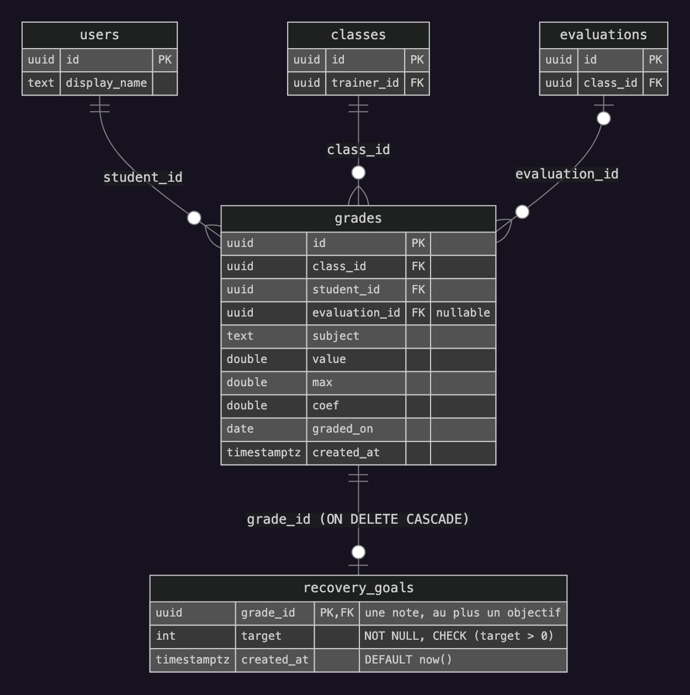
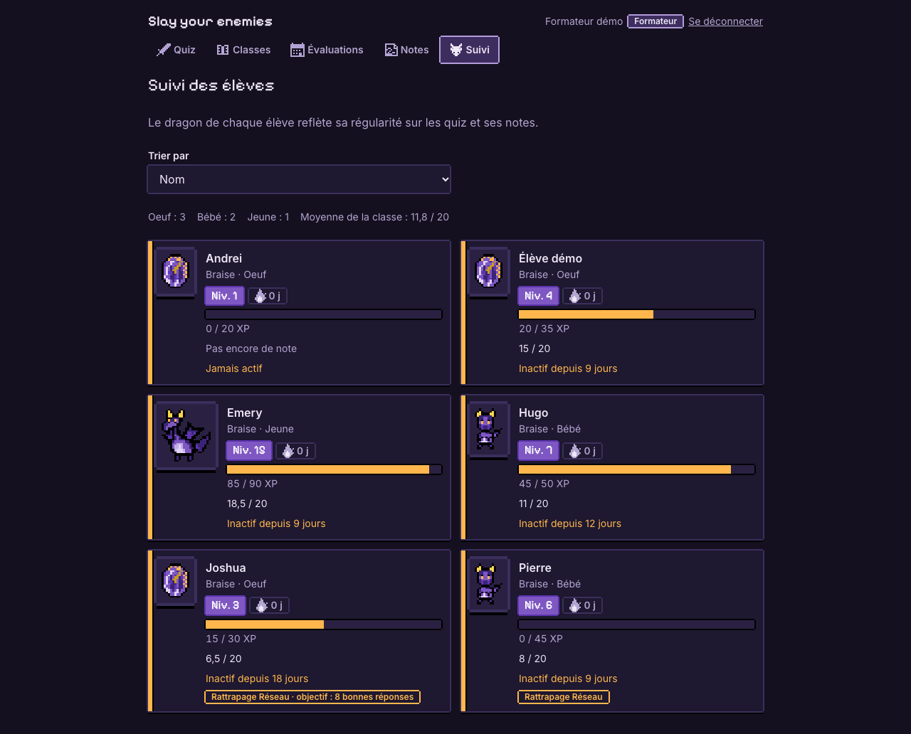
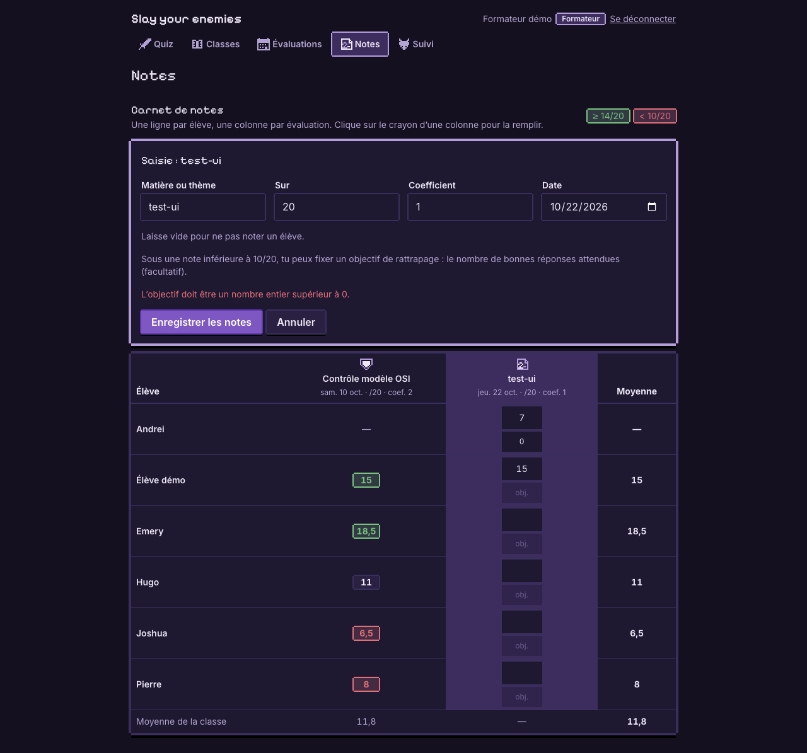

# Évolution : objectif de progression des plans de rattrapage

Slay your enemies, projet BTS SIO (CDD-QUIZ-2026-001). Demande de TechLearn Solutions.

## 1. La demande

Le formateur doit pouvoir fixer, pour chaque plan de rattrapage, un **objectif de progression personnalisé**.

| Règle de gestion | Mise en œuvre |
|---|---|
| L'objectif est un nombre de bonnes réponses | Entier `target` |
| Il est strictement positif | Contrôlé à l'écran, par l'API (400) et par la base (`CHECK`) |
| Un plan sans objectif garde son fonctionnement | Objectif facultatif, plans existants vérifiés identiques |

## 2. Rappel : comment naît un plan de rattrapage

Un plan n'est **pas enregistré** : il est **calculé** à partir des notes.

- Une note **inférieure à 10/20** ouvre un plan dans sa matière, pour **14 jours**.
- Une note correcte postérieure dans la même matière le ferme.
- Pendant le plan, chaque bonne réponse à un quiz du même thème rapporte de l'XP au dragon de l'élève.

L'objectif est donc rattaché à **la note qui ouvre le plan**.

## 3. Base de données : une table dédiée



```sql
CREATE TABLE recovery_goals (
    grade_id   uuid PRIMARY KEY REFERENCES grades(id) ON DELETE CASCADE,
    target     integer NOT NULL CHECK (target > 0),
    created_at timestamptz NOT NULL DEFAULT now()
);
```

- **Clé primaire = clé étrangère** : une note a au plus un objectif (relation 1 à 0..1).
- **`ON DELETE CASCADE`** : supprimer la note supprime son objectif.
- **`CHECK (target > 0)`** : la règle de gestion est garantie par la base elle-même.
- **Table `grades` inchangée** et **aucune donnée à migrer** : pas d'objectif = pas de ligne.
- Nouvelle migration `0003_objectif_rattrapage.sql`, appliquée au démarrage ; les migrations existantes ne sont pas modifiées (sqlx contrôle leur empreinte).

Démonstration de la contrainte :

```
=> INSERT INTO recovery_goals (grade_id, target) VALUES ((SELECT id FROM grades LIMIT 1), 0);
ERROR:  new row for relation "recovery_goals" violates check constraint "recovery_goals_target_check"
```

## 4. API

| Méthode | Route | Effet |
|---|---|---|
| POST | `/classes/{id}/grades` | Nouveau champ facultatif `recovery_target` par élève lors de la saisie des notes |
| PUT | `/grades/{id}/recovery-goal` | Définit ou modifie l'objectif d'une note existante (204) |
| DELETE | `/grades/{id}/recovery-goal` | Retire l'objectif (204) |

Les plans renvoyés au formateur et à l'élève contiennent désormais `target` (nombre ou `null`).

Contrôles, dans l'ordre :

1. objectif strictement positif, sinon **400** ;
2. note existante, sinon **404** ;
3. classe appartenant au formateur connecté, sinon **403** (élève) ou **404** (autre formateur, pour ne pas révéler la ressource) ;
4. note inférieure à 10/20, sinon **400** : un objectif n'a de sens que si un plan est ouvert.

**Saisie groupée et transaction** : les notes d'une classe sont enregistrées en un seul lot, dans une transaction. Un objectif invalide fait refuser **tout le lot** : aucune note n'est enregistrée.

## 5. Interface

**Tableau de bord du formateur** : le badge du plan affiche l'objectif ; un plan sans objectif est inchangé.



**Carnet de notes** : sous chaque note, un champ « obj. », actif seulement pour une note inférieure à 10/20. Une valeur invalide est signalée et rien n'est envoyé.



L'élève voit aussi l'objectif dans sa carte « Plan de rattrapage ».

## 6. Tests et vérifications

| Vérification | Résultat |
|---|---|
| `cargo test` (règles métier, fonctions pures) | **12 réussis** : 9 existants + 3 nouveaux (plan avec objectif, sans objectif, objectif de la dernière mauvaise note) |
| `smoke.sh` (scénario de bout en bout sur l'API) | **44 vérifications, 0 échec**, dont 16 nouvelles |
| Plans existants avant / après migration | **Identiques**, avec `target: null` |
| Contrainte `CHECK` et clé étrangère en base | Insertion de 0 et d'une note inconnue refusées |
| Suppression en cascade | Objectif supprimé avec sa note |
| `npm run lint`, `npm run build` | OK |
| `npm test` | 12 tests réussis ; 2 erreurs non gérées **déjà présentes avant** dans `Layout.test.tsx` (hors périmètre) |

Cas couverts par le scénario de bout en bout :

- objectif 0 → 400, objectif négatif → 400 ;
- lot refusé → nombre de notes inchangé ;
- objectif sur une note de 14/20 → 400 ;
- objectif 8 sur 7/20 → 201, visible dans le tableau de bord et chez l'élève ;
- `PUT` : 0 → 400, élève → 403, autre formateur → 404, note inconnue → 404, bonne note → 400, valeur valide → 204 ;
- `DELETE` → 204, le plan redevient sans objectif.

## 7. Choix et limites

- **Informatif** : l'objectif ne modifie pas le calcul d'XP.
- **Un objectif par plan** : celui de la dernière mauvaise note de la matière ; les objectifs d'anciennes notes restent en base sans être affichés.
- À la fermeture du plan, l'objectif n'est plus affiché mais reste en base.
- Le seuil de 10/20 existe côté serveur et dans le carnet de notes (limite déjà présente) ; le serveur reste la référence.

**Évolutions possibles** : suivre la progression (« 3 sur 8 bonnes réponses »), récompenser l'objectif atteint, l'afficher dans les quêtes de l'élève.

## 8. Fichiers modifiés

| Couche | Fichiers |
|---|---|
| Base | `backend/migrations/0003_objectif_rattrapage.sql`, `livrables/schema.sql`, `docs/schema.dbml` |
| Backend | `backend/src/xp.rs`, `backend/src/routes/grades.rs`, `classes.rs`, `pet.rs` |
| Frontend | `web/src/api/client.ts`, `web/src/i18n/fr.ts`, `DashboardPage.tsx`, `GradesPage.tsx`, `GradeBook.tsx` |
| Tests et docs | `backend/scripts/smoke.sh`, `docs/API.md` |
