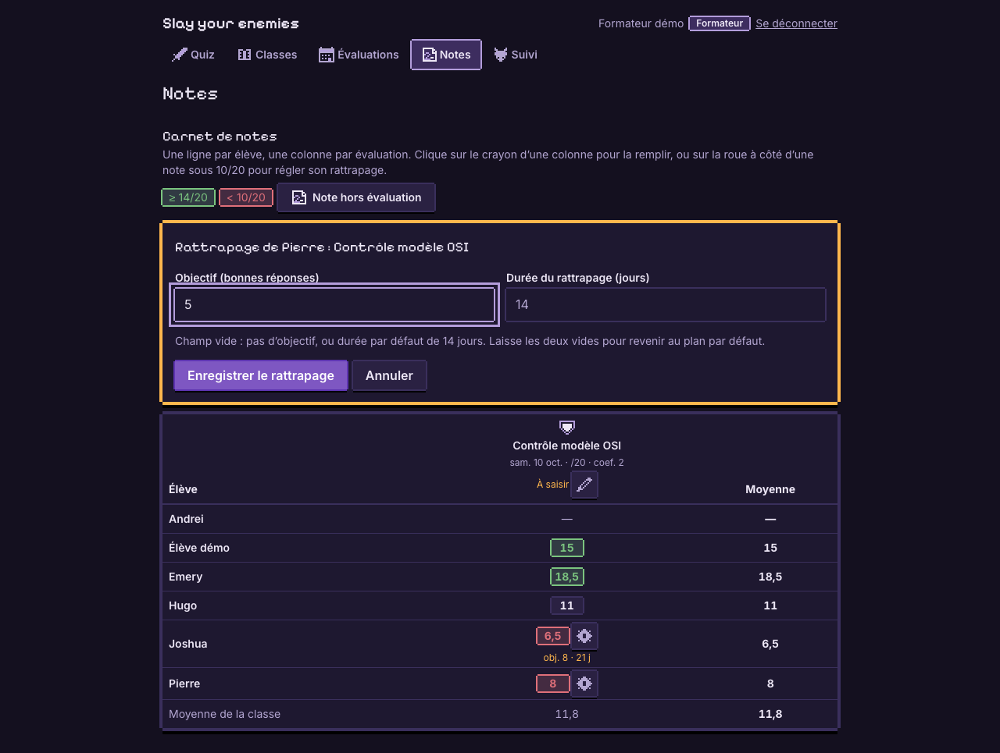

# Évolution : objectif et durée des plans de rattrapage

Slay your enemies, projet BTS SIO (CDD-QUIZ-2026-001). Demande de TechLearn Solutions.

## 1. La demande

Le formateur doit pouvoir personnaliser chaque plan de rattrapage :

| Règle de gestion | Mise en œuvre |
|---|---|
| Fixer un **objectif** : un nombre de bonnes réponses | Entier `target`, strictement positif |
| Changer la **durée** du plan (14 jours par défaut) | Entier `days`, de 1 à 365 |
| Un plan sans réglage garde son fonctionnement | Les deux sont facultatifs ; plans existants vérifiés identiques |

Chaque règle est contrôlée à l'écran, par l'API (erreur 400) et par la base (`CHECK`).

## 2. Rappel : comment naît un plan de rattrapage

Un plan n'est **pas enregistré** : il est **calculé** à partir des notes.

- Une note **inférieure à 10/20** ouvre un plan dans sa matière, pour **14 jours** ou la durée choisie par le formateur.
- Une note correcte postérieure dans la même matière le ferme.
- Pendant le plan, chaque bonne réponse à un quiz du même thème rapporte de l'XP au dragon de l'élève.

Objectif et durée sont donc rattachés à **la note qui ouvre le plan**. Grâce à ce calcul, ajouter la durée n'a changé qu'**une ligne** de la règle métier : la date de fin.

## 3. Base de données : une table dédiée


Deux migrations, une par demande :

```sql
-- 0003 : objectif
CREATE TABLE recovery_goals (
    grade_id   uuid PRIMARY KEY REFERENCES grades(id) ON DELETE CASCADE,
    target     integer NOT NULL CHECK (target > 0),
    created_at timestamptz NOT NULL DEFAULT now()
);

-- 0004 : durée
ALTER TABLE recovery_goals ALTER COLUMN target DROP NOT NULL;
ALTER TABLE recovery_goals ADD COLUMN days integer CHECK (days BETWEEN 1 AND 365);
ALTER TABLE recovery_goals ADD CONSTRAINT recovery_goals_not_empty
    CHECK (target IS NOT NULL OR days IS NOT NULL);
```

- **Clé primaire = clé étrangère** : une note a au plus une ligne de réglages (relation 1 à 0..1).
- **`ON DELETE CASCADE`** : supprimer la note supprime ses réglages.
- **`CHECK`** : les règles de gestion sont garanties par la base elle-même.
- **Pas de ligne = plan par défaut** ; une ligne porte au moins un réglage.
- **Table `grades` inchangée**, **aucune donnée à migrer**, migrations existantes non modifiées (sqlx contrôle leur empreinte).

Démonstration des contraintes :

```
=> INSERT INTO recovery_goals (grade_id, target) VALUES ((SELECT id FROM grades LIMIT 1), 0);
ERROR:  new row for relation "recovery_goals" violates check constraint "recovery_goals_target_check"
=> INSERT INTO recovery_goals (grade_id, days) VALUES ((SELECT id FROM grades LIMIT 1), 400);
ERROR:  new row for relation "recovery_goals" violates check constraint "recovery_goals_days_check"
```

## 4. API

| Méthode | Route | Effet |
|---|---|---|
| POST | `/classes/{id}/grades` | Champs facultatifs `recovery_target` et `recovery_days` par élève lors de la saisie des notes |
| PUT | `/grades/{id}/recovery-goal` | Définit ou remplace objectif et durée d'une note existante, `{ "target": 8, "days": 21 }` (204) |
| DELETE | `/grades/{id}/recovery-goal` | Retire les réglages : plan de 14 jours sans objectif (204) |
| GET | `/classes/{id}/grades` | Chaque note renvoie aussi `recovery_target` et `recovery_days`, pour afficher et préremplir ses réglages |

Les plans renvoyés au formateur et à l'élève contiennent `target` et `days` (nombre ou `null`). Leur date de fin `until` tient compte de la durée.

Contrôles, dans l'ordre :

1. objectif strictement positif, durée de 1 à 365 jours, sinon **400** ;
2. note existante, sinon **404** ;
3. classe appartenant au formateur connecté, sinon **403** (élève) ou **404** (autre formateur, pour ne pas révéler la ressource) ;
4. note inférieure à 10/20, sinon **400** : ces réglages n'ont de sens que si un plan est ouvert.

**Saisie groupée et transaction** : les notes d'une classe sont enregistrées en un seul lot, dans une transaction. Une valeur invalide fait refuser **tout le lot** : aucune note n'est enregistrée.

## 5. Interface

**Tableau de bord du formateur** : le badge du plan affiche l'objectif et la durée personnalisée ; un plan sans réglage est inchangé.


**Carnet de notes, à la saisie** :
- sous chaque note, un champ « obj. », actif seulement pour une note inférieure à 10/20 ;
- un champ « Durée du rattrapage (jours) » s'applique à toutes les notes de la saisie qui ouvrent un plan ;
- une valeur invalide est signalée et rien n'est envoyé.


**Carnet de notes, après coup** :
- un bouton roue à côté de chaque note inférieure à 10/20 ouvre un panneau de réglage, prérempli avec les valeurs actuelles ;
- les réglages en place sont résumés sous la note (« obj. 8 · 21 j ») ;
- vider les deux champs ramène au plan par défaut.



L'élève voit l'objectif dans sa carte « Plan de rattrapage » ; la date de fin affichée tient compte de la durée.

## 6. Tests et vérifications

| Vérification | Résultat |
|---|---|
| `cargo test` (règles métier, fonctions pures) | **14 réussis** : 9 d'origine et 5 nouveaux (objectif, durée, réglages de la dernière mauvaise note) |
| `smoke.sh` (scénario de bout en bout sur l'API) | **53 vérifications, 0 échec**, dont 25 nouvelles |
| Parcours dans le navigateur | Régler, modifier puis retirer les réglages d'une note existante : OK |
| Plans existants avant / après migrations | **Identiques**, avec `target: null` et `days: null` |
| Contraintes `CHECK` et clé étrangère en base | Objectif 0, durée 400, ligne vide et note inconnue refusés |
| Suppression en cascade | Réglages supprimés avec leur note |
| `npm run lint`, `npm run build` | OK |
| `npm test` | 12 tests réussis ; 2 erreurs non gérées **déjà présentes avant** dans `Layout.test.tsx` (hors périmètre) |

Cas couverts par le scénario de bout en bout :

- **Objectif** :
  - 0 ou négatif → 400, et le lot refusé laisse le nombre de notes inchangé ;
  - objectif sur une note de 14/20 → 400 ;
  - objectif 8 sur une note de 7/20 → 201, visible chez le formateur et chez l'élève.
- **Durée** :
  - 0 ou 366 → 400 ;
  - durée sur une note de 12/20 → 400 ;
  - 30 jours → date de fin exacte, aujourd'hui + 30.
- **`PUT` et `DELETE`** :
  - `PUT` vide → 400, élève → 403, autre formateur → 404, note inconnue → 404 ;
  - `PUT` de 7 jours → plan raccourci ;
  - les réglages apparaissent dans la liste des notes ;
  - `DELETE` → 204, le plan revient au fonctionnement par défaut.

## 7. Choix et limites

- **Objectif informatif** : il ne modifie pas le calcul d'XP.
- **Durée** : elle allonge ou raccourcit la période où les quiz du thème rapportent le bonus de rattrapage. Les règles de calcul ne changent pas, et l'XP déjà gagnée reste acquise.
- **Un réglage par plan** : celui de la dernière mauvaise note de la matière. Les réglages d'anciennes notes restent en base sans être utilisés.
- **Durée par saisie dans l'interface**, par élève dans l'API.
- **`PUT` remplace l'objectif et la durée ensemble.** L'interface préremplit et renvoie toujours les deux valeurs.
- **Bouton de réglage sur toute note sous 10/20**, même si son plan est fermé ou remplacé par une note plus récente.
- **Constantes en double** : le seuil de 10/20 et les durées existent côté serveur et dans le carnet de notes (limite déjà présente). Le serveur reste la référence.

**Évolutions possibles** :
- suivre la progression (« 3 sur 8 bonnes réponses ») ;
- récompenser l'objectif atteint ;
- régler la durée par défaut au niveau de la classe.

## 8. Fichiers modifiés

| Couche | Fichiers |
|---|---|
| Base | `backend/migrations/0003_objectif_rattrapage.sql`, `0004_duree_rattrapage.sql`, `livrables/schema.sql`, `docs/schema.dbml` |
| Backend | `backend/src/xp.rs`, `backend/src/routes/grades.rs`, `classes.rs`, `pet.rs` |
| Frontend | `web/src/api/client.ts`, `web/src/i18n/fr.ts`, `DashboardPage.tsx`, `GradesPage.tsx`, `GradeBook.tsx` |
| Tests et docs | `backend/scripts/smoke.sh`, `docs/API.md` |
